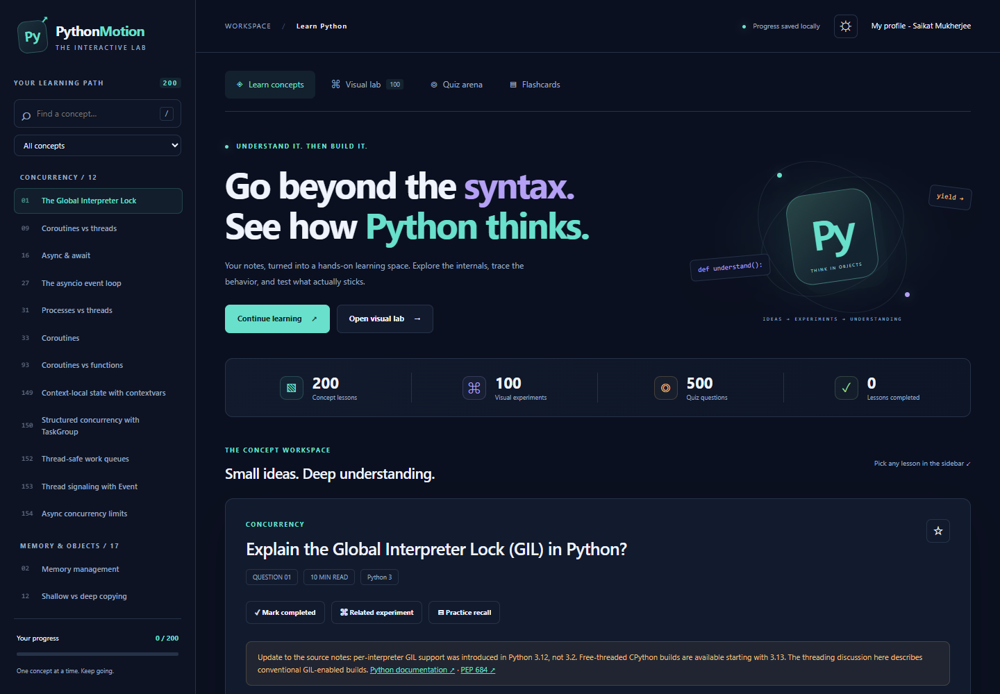
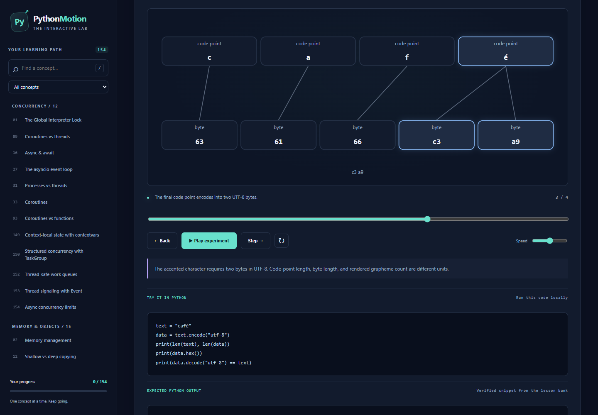
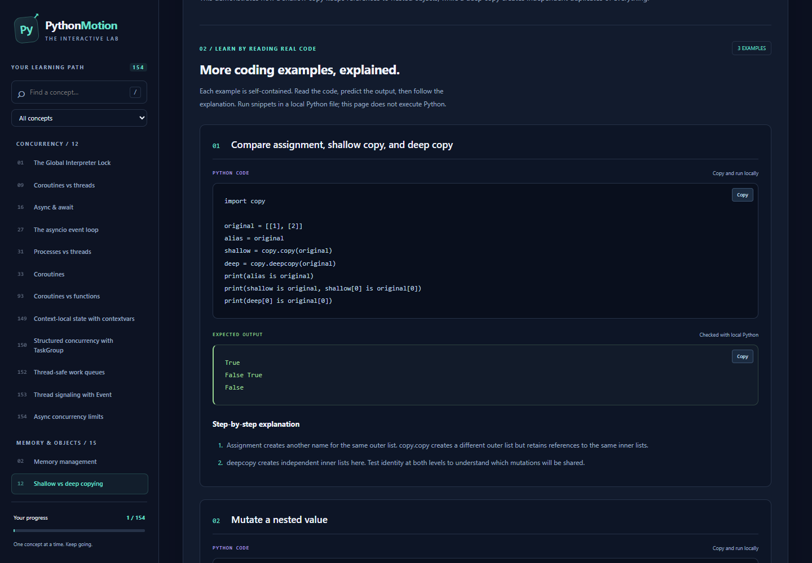

# Python Motion Lab

**Go beyond the syntax. See how Python thinks.**

A complete interactive Python learning website inspired by DSA Motion Lab, built from the supplied Python theory notes. Open it directly in a browser or host it on GitHub Pages. No application build, API key, backend, or network connection is required to use it.



## Start here

Double-click **index.html** to open the website. For a local server, with Node.js installed:

```sh
npm start
```

Open **http://127.0.0.1:4173**. Stop the server with Ctrl+C.

## What is inside

- **200 conceptual lessons** in six topic groups: 104 questions from the original notes, plus 96 additions numbered 106–201. Original numbers are retained; question 43 was absent from the supplied notes. Choose **Newest 10 concepts** for the latest batch or **Added concepts (96)** for all authored additions.
- **3–4 worked examples in every lesson**, each with runnable Python, checked expected output, and detailed step-by-step explanations. Each topic ends with a **simplest summary**, with jump controls for its answer, worked examples, and final takeaway. There are 604 added example placements, including 30 new snippets for the latest 10 additions. Repeated source revision questions share relevant concept examples; the complete lesson bank has 462 distinct runnable snippets.
- **Search** across titles and explanation text, bookmark filters, completion filters, reading estimates, previous/next navigation, and code-copy buttons.
- **100 visual experiments**: the original six, the first 50 additions, and the latest 44. Choose **Latest 44 additions** in the Collection filter to isolate this batch. Browse a searchable gallery, filter by concept or animation style, choose an experiment directly, or use **Surprise me**. New scenes include scope radar, closure graphs, docking arguments, recursion towers, gears, processing pipelines, decision trees, cleanup airlocks, cycle sweeping, descriptor elevators, property gauges, enum dials, hash buckets, histograms, deque trains, heap trees, stable sorting cards, Venn regions, byte windows, text scanners, numeric balances, clocks, thread intersections, permit pools, and event waveforms. The latest batch adds byte bridges, metadata passports, broadcast hubs, package maps, schema forms, exception-cause chains, logging checkpoints, and type-contract portals.
- **A separate quiz arena** with four shuffled choices, first-answer locking, immediate explanations, category selection, 10/20/all-question sessions, saved attempts, results, and retrying missed/unanswered questions. The hand-authored question bank covers the main concepts; it is not one question per source lesson.
- **Flashcards** for every source question, with all/bookmarked/unfinished decks and answer reveal.
- **Local progress**, light/dark themes, and responsive layouts.

The experiments simulate selected concepts in JavaScript. They do **not execute arbitrary Python**. All support stepping, back, reset, playback, speed adjustment, and timeline scrubbing. Each new experiment links to its source lesson and includes an independently executable Python snippet with checked output. Keyed SVG objects move between scene states, and reduced-motion preferences suppress transitional animation. [The full visual-lab catalogue](docs/VISUAL_LAB.md) documents all 100 experiments and simulation boundaries.





## GitHub Pages deployment

1. Create a GitHub repository, for example `python-motion-lab`.
2. Upload **the contents of this folder** so `index.html`, `assets`, and `.github` are at the repository root. Do not put the entire project inside another nested folder.
3. Use `main` as your default branch. If you choose another branch, update `.github/workflows/pages.yml`.
4. Open **Settings → Pages → Build and deployment → Source → GitHub Actions**.
5. Push to `main` or run the **Deploy Python Motion Lab to GitHub Pages** workflow manually.
6. When it finishes, open the URL shown by the deployment, normally `https://YOUR-USERNAME.github.io/YOUR-REPOSITORY/`.

**Clicking index.html on github.com displays its source. Use the deployed GitHub Pages URL to see the website.**

Alternatively, choose **Deploy from a branch → main → /(root)** in Pages settings. This is a static website and does not need a build process.

The included workflow follows [GitHub's custom Pages workflow documentation](https://docs.github.com/en/pages/getting-started-with-github-pages/using-custom-workflows-with-github-pages).

## Repository structure

```text
python-motion-lab/
├── index.html                    # Complete app shell
├── assets/
│   ├── style.css                 # Responsive dark/light interface
│   ├── app.js                    # Lessons, quiz, flashcards, persistence
│   ├── lessons.js                # Generated full lesson bank
│   ├── quizzes.js                # Original 58 four-option questions
│   ├── quizzes-more.js           # First 100-question extension
│   ├── quizzes-342.js            # Latest 342-question extension
│   ├── labs.js                   # Six deterministic visual simulations
│   ├── lab-experiments.js        # First fifty additional traces
│   ├── lab-experiments-more.js   # Latest forty-four additional traces
│   ├── lab-scenes.js             # Responsive keyed SVG scene renderers
│   ├── lab-styles.css            # Experiment gallery and animation styling
│   └── vendor/                   # Local Markdown renderer and its license
├── content/python-notes.md       # Unmodified supplied source notes
├── content/additional/           # 50 authored conceptual lessons + 150 examples
├── scripts/
│   ├── build-content.cjs         # Rebuild lessons from source
│   └── serve.cjs                 # Optional local HTTP server
├── tests/                        # Content and browser behavior checks
├── docs/CONTENT.md               # Content provenance and corrections
└── .github/workflows/pages.yml   # GitHub Pages deployment
```

## Updating content

Edit `content/python-notes.md` and run `npm run build:content`. Edit `assets/quizzes.js` to extend the quiz bank and `assets/labs.js` to add experiments. Lesson IDs come from the numbered source headings and must remain unique. Keep question numbers in ascending order when editing the source.

The expanded examples and simplest summaries are authored in `content/examples/*.cjs`. The content builder requires coverage for every lesson and embeds the additions into `assets/lessons.js`. Original source notes remain intact. Update those source modules and rebuild rather than editing the generated file directly.

The 50 additional questions, answers, and examples live in `content/additional/*.cjs`. They cover scoping, mutable defaults, parameter conventions, unpacking, comprehensions, assignment expressions, structural matching, truthiness, comparisons, sorting, exceptions, files, encodings, JSON/CSV, timezones, numeric types, Unicode, regex, collection tools, typing, logging, testing, imports, attribute access, partial application, recursion, context variables, TaskGroup, async generators, and thread/async coordination. The separate quiz bank contains 500 questions. The visual lab now contains 100 experiments with its own navigation and styles.

## Validation

```sh
npm test
```

With Python 3.11+ available, check that all distinct authored snippets actually produce their documented stdout:

```sh
python tests/examples.py
```

The output checks use temporary `.py` files and separate Python processes, including for multiprocessing and source-inspection examples. They do not execute the old source-note snippets. Outputs were verified locally with CPython 3.12.14. The site displays outputs rather than running Python in the browser. Run assertions examples without `-O`; set/frozenset displays are sorted to avoid order-dependent output, and concurrency examples avoid timing promises.

For browser interaction tests, install the optional development dependency:

```sh
npm install
npx playwright install chromium
npm run test:browser
npm run test:examples-browser
npm run test:labs
npm run test:lab-examples
```

If Microsoft Edge is already installed on Windows, the browser suite uses it automatically. Set `PML_PLAYWRIGHT_PATH` to an existing Playwright module path to reuse a local installation without installing packages in this repository.

## Privacy and accessibility

No analytics, tracking, login, CDN requests, or external fonts. Progress stays in browser local storage. Storage is specific to the browser and origin; moving from a local file to a hosted URL starts a separate progress record. Clearing browser data clears local progress.

The interface supports keyboard navigation, visible focus, a skip link, labeled controls, live quiz feedback, reduced motion preferences, and mobile screens. Press `/` outside a form control to search. On flashcards, press Space outside a control to reveal an answer.

The supplied notes remain the primary learning material and have not undergone an exhaustive technical audit. Targeted corrections and their primary sources are documented in [docs/CONTENT.md](docs/CONTENT.md). The vendored Marked library retains its MIT license in `assets/vendor/MARKED-LICENSE.md`. No new license is asserted over the user-provided notes.

### Quiz arena: 100 additional questions

The first quiz extension added 100 questions to the original 58, covering lessons 106–155. The subsequent 342-question extension brings the current total to 500. Each new lesson has one conceptual question and one code-output question, with four choices, detailed feedback, and a related lesson link. Use the collection filter to practice the new 100, original 58, or all questions. Code and multiline output retain their formatting in questions and review. Existing quiz IDs and saved attempts remain valid.

The additions live in `assets/quizzes-more.js`. Its 50 code-output questions reuse lesson examples; `node tests/quiz-manifest.cjs` followed by `python tests/quiz-examples.py` executes each snippet and compares its stdout with the correct answer.

### Quiz arena: 342 more questions, 500 total

The latest batch adds 68 conceptual questions and 274 code-output questions. Its programs are distinct from the 50 code questions in the earlier batch, giving the full bank 324 distinct runnable programs. Topics include object lifetimes, generators, decorators, descriptors, inheritance, concurrency, typing, exceptions, data formats, collections, testing, and numerical behavior. Every question has four distinct choices, explanatory feedback, and a related lesson link.

Choose **Newest 342 questions**, **Previous 100 questions**, **Original 58 questions**, or all 500. Topic filters and 10-question, 20-question, or all-matching sessions work with each collection. Existing question IDs q1–q158 and saved attempts retain their meaning; new IDs are q159–q500.

The source for the conceptual additions is `content/quiz-342-concepts.txt`. Run `npm run build:quiz` to rebuild `assets/quizzes-342.js`, which also selects distinct worked examples and supplies output distractors. Run `npm test`, `npm run test:quiz-examples`, and `npm run test:browser` to validate the bank, execute all 324 programs, and exercise quiz interactions.

### Learn concepts: 36 additional topics

Lessons **156–191** add slicing, range, dictionary views, set algebra, join, splitting, format specifications, bytearray, ChainMap, mapping proxies, typed arrays, struct, groupby, tee, accumulate, cached_property, operator helpers, secrets, local random generators, hashlib, HMAC, Base64, URL parsing, statistics, approximate comparisons, timeit, pprint, textwrap, argparse, ConfigParser, temporary files, SQLite, subprocesses, ZIP archives, singledispatchmethod, and dataclass replacement/conversion.

Each includes a direct answer, use cases, a common mistake, three independently runnable examples with expected outputs and two explanatory paragraphs each, and a simplest summary at the end. The 36 lessons and 108 examples are authored in `content/additional/{collections-text,tools-security,applications}-36.cjs` and regenerated with `npm run build:content`. They are included in search, bookmarking, completion, navigation, and the 200-card flashcard deck. Existing lesson IDs and quiz questions retain their meaning.

### Learn concepts: 10 more topics, 200 total

Lessons **192–201** cover TOML configuration, IP address and network values, filename wildcard matching, combinatorial iterators, trusted pickle graphs, total_ordering, UserDict mappings, Gregorian calendar calculations, XML trees, and HTML escaping/parsing. Each has a direct answer, use cases, a common mistake, three checked examples with expected output and detailed explanations, and a simplest summary at the end.

Use **Newest 10 concepts** to browse this batch, **Previous 36 concepts** for the preceding batch, or **Added concepts (96)** for every authored addition. The source is `content/additional/practical-10.cjs`; run `npm run build:content` to rebuild the lesson asset. All 200 lessons participate in search, navigation, bookmarking, completion, and flashcards. The lesson bank now contains 604 example placements and 462 distinct runnable snippets.

The arrow handle on the left edge slides the lesson index away to expand the reading area. Click it again to restore the panel; the choice is saved in this browser. On smaller screens, use the existing menu button. The `/` shortcut opens the index and focuses search. Run `npm run test:sidebar` to check this behavior.
